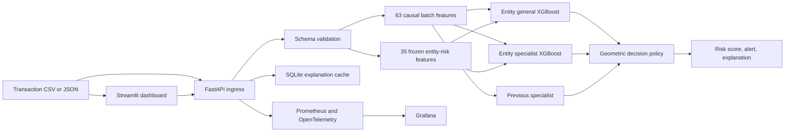

# AML Risk Intelligence: end-to-end guide

This document is the single operational path from local data to a validated model, API, Streamlit dashboard, monitoring stack, and rollback. The active `entity-v3` release reaches **81.03% recall at 21.35% precision** on the corrected chronological HI-Small test split.

## 1. System architecture



Each uploaded CSV is an independent chronological batch. Causal features use only earlier rows in that batch. Entity features use a frozen training-cutoff registry and are never updated from uploaded rows or labels.

## 2. Project folder architecture

```text
AML_production/
├── aml_app/
│   ├── main.py                 FastAPI routes, validation limits and metrics
│   ├── service.py              Artifact loading, ensemble scoring and explanations
│   ├── pipeline.py             Shared 63-feature causal batch pipeline
│   ├── entity_features.py      Hashed training-registry feature contract
│   ├── artifacts.py            Bundle schema, version and checksum validation
│   ├── evaluation.py           TP/FP/FN/TN and threshold evaluation helpers
│   ├── cache.py                Shared SQLite explanation cache
│   ├── history.py              Optional dashboard history persistence
│   ├── observability.py        Trace-safe logging and OpenTelemetry setup
│   └── schemas.py              JSON request schema
├── training/
│   ├── train.py                Build the causal-v2 baseline and split cache
│   ├── train_entity_v3.py      Build the entity-v3 ensemble and release bundle
│   ├── evaluation.py           Precision-constrained operating-point selection
│   └── promote.py              Atomic promotion with rollback backup
├── tests/                      Feature, registry, evaluation and serving regressions
├── scripts/
│   ├── check_stack.py          Live stack verification
│   └── verify_autoscaling.py   Ray replica/load verification
├── observability/
│   ├── grafana/                Provisioned dashboards and data sources
│   ├── prometheus/             Scrape configuration and alert rules
│   ├── loki/                   Log storage configuration
│   ├── tempo/                  Trace storage configuration
│   └── otel/                   OpenTelemetry collector configuration
├── docs/
│   ├── END_TO_END.md           This guide
│   ├── RESULTS.md              Locked evaluation results
│   ├── RECALL_MODEL_REVIEW.md  Model comparisons and limitations
│   ├── FEATURE_AUDIT.md        Leakage and feature-semantics audit
│   └── OPERATIONS.md           Monitoring and operational details
├── data/                       Local-only raw/test data; ignored everywhere
├── artifacts/                  Reproducible training output; ignored and disposable
├── production_artifacts/       Active checksummed release; ignored, mounted at runtime
├── production_artifacts.backup-*/  Most recent rollback release; ignored
├── dashboard.py                Streamlit investigation UI
├── serve_app.py                Ray Serve deployment entry point
├── replica_monitor.py          Streamlit replica/load monitor
├── load_test.py                Concurrent API load generator
├── Dockerfile                  Runtime image; never copies data or model artifacts
├── docker-compose.yml          API, UI, Ray and observability stack
├── requirements.txt            Runtime dependencies
├── requirements-dev.txt        Test/lint dependencies
└── requirements-training.txt   Offline training dependencies
```

The `artifacts/` directory is absent in a clean runtime checkout and is created only by training. The active model is supplied separately through `production_artifacts/`.

## 3. Prerequisites

- Python 3.11 or newer.
- Docker with Compose for the complete local stack.
- The HI-Small transaction CSV and pattern file for retraining only.
- Enough disk space for temporary NumPy feature matrices. Baseline training can require several gigabytes.

Create the environment:

```bash
python -m venv .venv
source .venv/bin/activate
pip install -r requirements-dev.txt
pip install -r requirements-training.txt
```

## 4. Data placement and protection

Recommended local layout:

```text
data/
├── raw/HI-Small_Trans.csv
├── external/HI-Small_Patterns.txt
└── dashboard_test_2022-09-09_12.csv
```

`data/` is ignored by Git and Docker. The Dockerfile copies explicit application files rather than the workspace. Model releases contain trained boosters, fixed-size hashes and aggregate counts; they do not contain raw transaction rows or clear-text account identifiers.

Required transaction fields are:

```text
timestamp, from_bank, from_account, to_bank, to_account,
amount_received, receiving_currency, amount_paid,
payment_currency, payment_format
```

Training additionally requires `Is Laundering`. Leading zeros in identifiers are preserved.

## 5. Train the baseline

The baseline stage creates strict 60/10/10/20 chronological train, tune, calibration and test partitions and the 63 causal features:

```bash
python -m training.train \
  --data data/raw/HI-Small_Trans.csv \
  --patterns data/external/HI-Small_Patterns.txt \
  --output artifacts/causal-v2 \
  --precision-floor 0.15 \
  --trees 400 \
  --jobs 2
```

Use a new output directory if that path already contains a completed bundle. Never overwrite an immutable result.

## 6. Train entity-v3

The second stage builds a hashed training registry, creates leave-one-out entity features for training, trains the general and patterned-specialist models, chooses the declared policy on tune, and locks its threshold on calibration:

```bash
python -m training.train_entity_v3 \
  --data data/raw/HI-Small_Trans.csv \
  --base artifacts/causal-v2 \
  --output artifacts/entity-v3 \
  --jobs 2
```

The script verifies that the source-data hash and chronological labels match the baseline. Its release contains a manifest with checksums for every required file.

## 7. Evaluation protocol

The four partitions have distinct responsibilities:

| Split | Purpose |
|---|---|
| Train | Fit models and frozen aggregate registry |
| Tune | Early stopping and policy selection |
| Calibration | Lock the production threshold |
| Test | Final reporting after model and threshold selection |

Do not select thresholds from the test result. Review [RESULTS.md](RESULTS.md) for the active confusion matrix and [RECALL_MODEL_REVIEW.md](RECALL_MODEL_REVIEW.md) for rejected candidates and external-validity limitations.

## 8. Promote or roll back a release

Promotion validates model/feature compatibility, checksums and acceptance gates. It moves the current release to a timestamped rollback directory:

```bash
python -m training.promote artifacts/entity-v3 \
  --target production_artifacts \
  --minimum-recall 0.80 \
  --minimum-precision 0.20
```

To roll back, stop the service, move the current `production_artifacts/` aside, rename the selected valid `production_artifacts.backup-*` directory to `production_artifacts/`, and start the service again. Never merge individual files from different releases.

## 9. Run locally without Docker

Terminal one:

```bash
source .venv/bin/activate
uvicorn aml_app.main:app --host 127.0.0.1 --port 8000
```

Terminal two:

```bash
source .venv/bin/activate
streamlit run dashboard.py
```

Open `http://localhost:8501`. API documentation is available at `http://localhost:8000/docs`.

## 10. Run the complete stack

```bash
docker compose up --build -d
```

The principal interfaces are:

| Service | Address |
|---|---|
| Streamlit dashboard | `http://localhost:8501` |
| FastAPI | `http://localhost:8000` |
| Ray dashboard | `http://localhost:8265` |
| Replica monitor | `http://localhost:8502` |
| Grafana | `http://localhost:3000` |
| Prometheus | `http://localhost:9090` |

Compose mounts `production_artifacts/` at runtime. Neither that directory nor `data/` is baked into the image.

## 11. Score transactions

Readiness:

```bash
curl http://127.0.0.1:8000/health
curl http://127.0.0.1:8000/model
```

Single transaction:

```bash
curl -X POST http://127.0.0.1:8000/predict \
  -H 'content-type: application/json' \
  -d '{
    "timestamp":"2022-09-09T12:00:00Z",
    "from_bank":"001",
    "from_account":"800000001",
    "to_bank":"002",
    "to_account":"800000002",
    "amount_received":1000,
    "receiving_currency":"US Dollar",
    "amount_paid":1000,
    "payment_currency":"US Dollar",
    "payment_format":"ACH"
  }'
```

CSV batch:

```bash
curl -X POST http://127.0.0.1:8000/predict/csv \
  -F 'file=@data/dashboard_test_2022-09-09_12.csv'
```

Configure `AML_API_KEY` and send `x-api-key` when authentication is enabled. Production mode refuses to become ready without an API key.

## 12. Dashboard ground-truth evaluation

Upload a labelled CSV, enable **Compare alerts with actual labels**, and select `Is Laundering`. The dashboard reports TP, FP, FN, TN, precision, recall, specificity, F1 and accuracy. The low-range slider previews another score threshold but does not modify the deployed policy.

Labels remain in dashboard evaluation only. They are dropped before API feature engineering and never update the entity registry.

## 13. Verification

Run static and regression checks:

```bash
python -m pytest tests -q
ruff check aml_app/artifacts.py aml_app/entity_features.py aml_app/service.py \
  training/train_entity_v3.py tests/test_entity_features.py dashboard.py
python -m py_compile dashboard.py aml_app/*.py training/*.py
```

Verify a running stack:

```bash
python -m scripts.check_stack
python -m scripts.verify_autoscaling
```

Load generation:

```bash
python load_test.py --help
```

## 14. Monitoring and persistence

- `/metrics` exposes bounded-cardinality Prometheus metrics.
- OpenTelemetry exports operational metadata only; transactions and identifiers are not attached to spans or logs.
- Grafana combines Prometheus, Tempo and Loki views.
- Dashboard history is session-only unless `AML_PERSIST_HISTORY=true`.
- The shared explanation cache is SQLite with TTL and size limits.

See [OPERATIONS.md](OPERATIONS.md) for credentials, alerts, traces, cache behavior and autoscaling checks.

## 15. Generated files and cleanup

These paths are reproducible or runtime-generated and may be removed when their contents are no longer required:

```text
artifacts/
mlruns/
mlflow.db
.pytest_cache/
.ruff_cache/
**/__pycache__/
```

Do not delete `production_artifacts/` while the service is expected to start. Retain at least one validated rollback bundle. Do not commit or package anything under `data/`.
